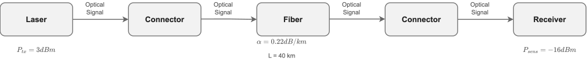

# 01 — Optical System Validation
This project implements a Python toolkit for validating optical communication links through reusable modeling, simulation, and analysis.

## System Model

  

The received optical power is computed by subtracting the accumulated insertion loss from the transmitted optical power.

## Overview

Optical link validation is one of the most fundamental engineering tasks in optical communication systems.

This project provides reusable Python modules for evaluating optical power budgets and validating whether a communication link satisfies receiver requirements.

The toolkit is designed as the foundation for more advanced optical system simulations.

## Features

✔ Link Budget Calculation

✔ Fiber Loss Modeling

✔ Receiver Sensitivity Validation

✔ System Margin Evaluation

✔ Modular Python Implementation

✔ Reusable Engineering Components

## Example Results

tx_power = 3
fiber_length = 40
attenuation = 0.22
connector_loss = 1

Output: 
Receiver Power : -7.8 dBm
System Margin : 8.2 dB
PASS

## Repository Structure
link_budget.py
validation.py
example_link.py

## Future Work

- EDFA modeling
- ASE noise
- OSNR estimation
- Receiver noise
- BER prediction

