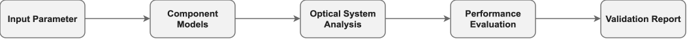

# 01 — Optical System Validation
This project implements a Python toolkit for validating optical communication links through reusable modeling, simulation, and analysis.

## Overview

Optical link validation determines whether the optical power delivered
to a receiver satisfies its sensitivity and system-margin requirements.

The first milestone implements a configurable point-to-point optical
link-budget model. It evaluates accumulated link loss, received optical
power, available margin, required engineering margin, and pass/fail
status.

Future milestones will extend the framework to amplified links, optical
signal-to-noise ratio analysis, receiver noise, and automated validation
reports.

## System Model
<p align="center">
  
</p>

The initial system consists of a transmitter, passive connection losses,
an optical fiber channel, and a receiver.

The received optical power is computed by subtracting the accumulated insertion loss from the transmitted optical power. 

## Workflow

<p align="center">
  
</p>


## Features

✔ Link Budget Calculation

✔ Fiber Loss Modeling

✔ Receiver Sensitivity Validation

✔ System Margin Evaluation

✔ Modular Python Implementation

✔ Reusable Engineering Components

## Mathematical Model

The accumulated fiber loss is

$$
L_{\mathrm{fiber}} = \alpha L
$$

and the received optical power is

$$
P_{\mathrm{RX}}
=
P_{\mathrm{TX}}
-
L_{\mathrm{total}}.
$$

The link passes when the available margin exceeds the required
engineering margin.


## Example Results

For a 40 km link with 3 dBm transmitter power, 0.22 dB/km fiber
attenuation, 1 dB connector loss, −16 dBm receiver sensitivity, and a
3 dB required engineering margin:

```text
Fiber loss:       8.80 dB
Total loss:       9.80 dB
Receiver power:  -6.80 dBm
Available margin: 9.20 dB
Net margin:       6.20 dB
Status:           PASS
```

## Repository Structure
```text
01_optical_system_validation/
├── README.md
├── models/
│   ├── __init__.py
│   └── link_budget.py
├── examples/
│   └── basic_link.py
└── figures/
    ├── system_model.drawio
    ├── system_model.svg
    └── power_waterfall.png
```

The corresponding unit tests are stored in the repository-level
`tests/` directory.

## Planned Extensions

- Component-by-component power waterfall
- Received power versus fiber distance
- Maximum supported distance
- Parameter validation and informative error handling
- EDFA gain and ASE noise
- OSNR estimation
- Automated validation reports

